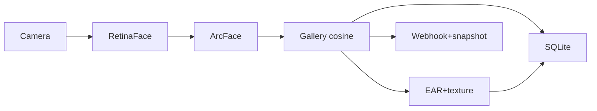

# FaceAttend

Privacy-first, real-time face-recognition attendance system with liveness (anti-spoofing) detection.

**Stack:** insightface (RetinaFace + ArcFace) · OpenCV · FastAPI · SQLite · MediaPipe

## Features
- Real-time face detection & recognition (ArcFace embeddings, cosine matching)
- Attendance logging with dedup window to SQLite + CSV export
- Active (blink/EAR) + passive (texture) liveness detection
- Unknown-person alerts with snapshot + webhook
- Privacy: consent gate, retention purge, right-to-erasure, audit log
- FastAPI REST + WebSocket (browser `getUserMedia`) + OpenCV local mode
- Dockerized, CI (lint/type/test/docker-build)

## Quickstart
```bash
uv sync --extra dev
cp .env.example .env
uv run python scripts/enroll.py --name "Alice" --images ./photos/alice --consent
uv run uvicorn faceattend.api.main:app --reload
# open http://localhost:8000
```
Local camera mode:
```bash
uv run python scripts/run_camera.py
```

## Architecture
See `docs/ARCHITECTURE.md`. Mermaid diagram:


## Configuration
See `.env.example`.

## Evaluation
See `docs/EVALUATION.md`. (To be populated with measured metrics.)

## Privacy
See `docs/PRIVACY.md`. Embeddings are biometric data; consent required; erasure supported.

## Deployment
See `docs/DEPLOYMENT.md`.

## License
MIT. Note: insightface `buffalo_l` is research/non-commercial; see `docs/MODEL_CARD.md`.